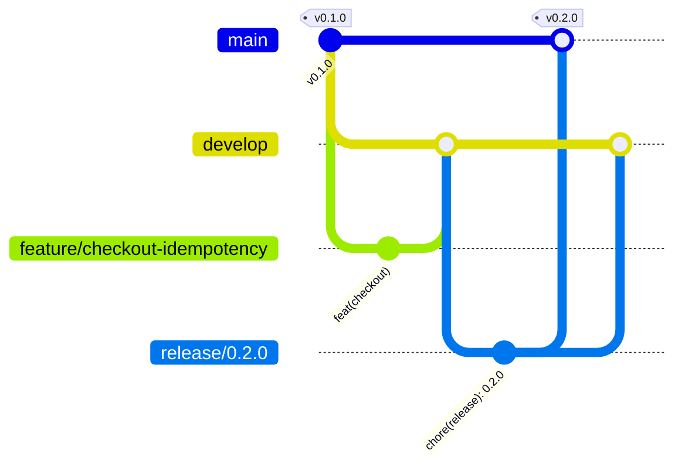

# Contributing

## Prerequisites

- Docker + Docker Compose v2
- Node.js 22 (optional — `./scripts/npx.sh` runs tools inside the `node:22` image when Node is missing)
- `make`, `curl`

## Setup

```bash
npm install          # also installs git hooks (husky)
cp .env.example .env # optional
make up              # or `make obs` for the observability stack
curl localhost:3000/health
```

## Language

Everything is written in **English**: code, identifiers, comments, logs, docs, commit messages and PR descriptions.
The one exception is `README.pt-BR.md`, a Brazilian Portuguese translation of the README for the challenge
reviewers. The English `README.md` is the source of truth; change both together.

## Branching model (Git flow)

| Branch                   | From      | Merges into            | Purpose                                             |
| ------------------------ | --------- | ---------------------- | --------------------------------------------------- |
| `main`                   | —         | —                      | Released code only. Every merge is tagged `vX.Y.Z`. |
| `develop`                | `main`    | —                      | Integration branch; always green.                   |
| `feature/<scope>-<desc>` | `develop` | `develop` (PR, squash) | New work, e.g. `feature/checkout-idempotency`.      |
| `release/<x.y.z>`        | `develop` | `main` + `develop`     | Version bump, CHANGELOG, last fixes.                |
| `hotfix/<desc>`          | `main`    | `main` + `develop`     | Urgent production fix.                              |



Rules:
- Never commit directly on `main` or `develop`. The `pre-push` hook blocks pushes to them
  (maintainers finishing a release/hotfix use `ALLOW_PROTECTED_PUSH=1 git push`).
- Keep feature branches short-lived; rebase on `develop` before opening the PR.
- Versioning follows SemVer: `feat` → minor, `fix`/`perf` → patch, `!`/`BREAKING CHANGE` → major.

### Common commands

```bash
# feature
git switch develop && git pull
git switch -c feature/catalog-cache

# release
git switch develop && git switch -c release/0.2.0
npm version 0.2.0 --no-git-tag-version   # update CHANGELOG.md, then commit
git switch main && git merge --no-ff release/0.2.0 && git tag -a v0.2.0 -m "v0.2.0"
git switch develop && git merge --no-ff release/0.2.0

# hotfix
git switch main && git switch -c hotfix/erp-timeout
```

## Commit messages

[Conventional Commits](https://www.conventionalcommits.org/), enforced by commitlint:

```
<type>(<scope>): <imperative subject, lower case>

[optional body: why, not what]

[optional footer: BREAKING CHANGE: ..., Refs #12]
```

- Types: `feat`, `fix`, `perf`, `refactor`, `test`, `docs`, `chore`, `ci`, `build`.
- Scopes: `catalog`, `checkout`, `orders`, `invoicing`, `worker`, `api`, `shared`, `infra`, `obs`, `docs`, `deps`, `release`.

## Git hooks

| Hook         | Runs                                       |
| ------------ | ------------------------------------------ |
| `pre-commit` | `biome check --staged` + `tsc --noEmit`    |
| `commit-msg` | `commitlint`                               |
| `pre-push`   | blocks direct pushes to `main` / `develop` |

## CI

[`.github/workflows/ci.yml`](.github/workflows/ci.yml) runs on every push and pull request to `main` / `develop`:

- `check`: `npm run check` (Biome, `tsc`, README sync).
- `test`: `npm test` against Postgres, Redis and ElasticMQ service containers plus the ERP mock started from
  `erp-mock/server.mjs`. The coverage gate fails the job; the report is uploaded as the `coverage-report` artifact
  and the totals are written to the job summary.
- `load` (manual only): Actions → CI → _Run workflow_ with `load` checked. Brings the compose stack up with
  `make reset && make up`, runs `make load` and asserts in Postgres that the SKU was not oversold.

## Code style

- Biome formats and lints (`npm run format`, `npm run lint`). Don't fight the formatter.
- Module layout and conventions: see `CLAUDE.md` and `.claude/rules/`.
- Comments explain _why_. Money is integer cents. Env via `src/shared/config.ts` only.

## Pull request checklist

- [ ] Branch follows Git flow and targets the right base (`develop` for features).
- [ ] `npm run check` and `npm test` pass.
- [ ] Tests cover the change (concurrency/idempotency/cache/worker paths where relevant).
- [ ] `docs/openapi.yaml` updated for API changes.
- [ ] `README.md` changed? `README.pt-BR.md` updated too (`sh scripts/check-readme-sync.sh` checks the structure).
- [ ] Metrics match the README contract and `infra/prometheus/alerts.yml`.
- [ ] ADR added in `docs/adr/` for architectural decisions.
- [ ] Schema change? Mention that `make reset` is required.
- [ ] `PROMPTS.md` updated if AI assistance was meaningful.
- [ ] `CHANGELOG.md` `Unreleased` section updated.

## Testing failure modes

```bash
make chaos                        # 30% ERP errors + 20% timeouts
make calm
make reset && make up && make load  # overselling + double click race
```
