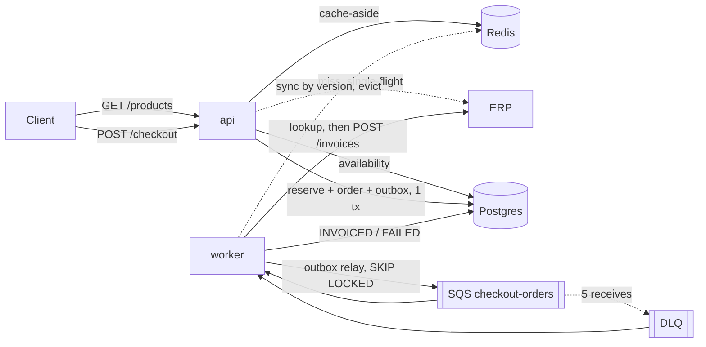
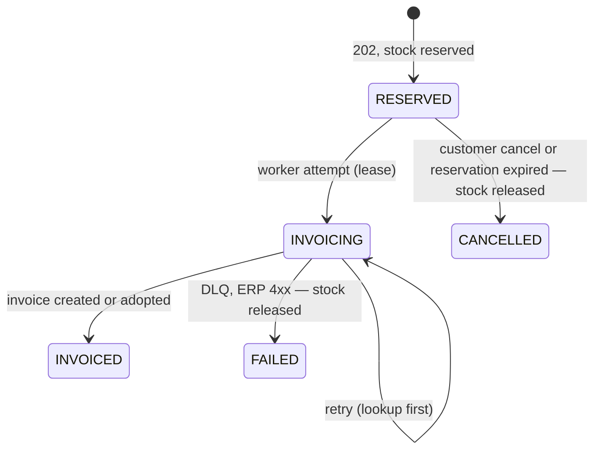

# CaseCellShop — Senior Backend Technical Challenge

[](https://github.com/leilton/casecellshop/actions/workflows/ci.yml)

**English** · [Português (Brasil)](README.pt-BR.md)

> Fictional company. 100% local environment: no cloud or Datadog account required.

A small backend that shows how to put a fast, correct storefront and an asynchronous checkout in front of a
slow, unstable ERP. It covers the three problems of the case:

| Problem              | What this service does                                                                                         |
| -------------------- | -------------------------------------------------------------------------------------------------------------- |
| Slow storefront      | `GET /products` from a Redis cache with TTLs per data type, single-flight and stale-if-error; ERP sync by version |
| Overselling          | Stock reserved in the shop's own Postgres with one atomic conditional `UPDATE`; idempotent checkout             |
| Slow ERP invoicing   | `202 Accepted` + transactional outbox + SQS worker with backoff, lookup-before-retry, DLQ and reconciliation    |

Measured locally (see [Verification](#verification)): `GET /products` p95 **4.8 ms** with a **99%** hit ratio
against an ERP that takes 300–500 ms; **10 of 200** racing checkouts accepted for 10 units, 0 oversold; under 30%
ERP errors + 20% timeouts, **0** duplicate invoices.

## Contents

- [Quick start](#quick-start)
- [API](#api)
- [How it works](#how-it-works)
- [Peak protection at checkout](#peak-protection-at-checkout)
- [Decisions and trade-offs](#decisions-and-trade-offs)
- [Observability: logs, metrics, traces, SLOs, alerts](#observability)
- [Tests](#tests)
- [Verification](#verification)
- [Simplifications and limitations](#simplifications-and-limitations)
- [Project layout and docs](#project-layout-and-docs)
- [AI usage](#ai-usage)

## Quick start

Requirements: Docker with Compose v2, `make`, `curl`. Node is optional (`./scripts/npx.sh` runs tools in a
container).

```bash
make up                         # api, worker, erp-mock, postgres, redis, sqs
curl localhost:3000/health      # postgres, redis, sqs, erp = ok
make test                       # 174 tests + coverage (runs inside the api container)
make obs                        # + otel-collector, jaeger, prometheus, grafana (exports traces)
```

Without `make`: `docker compose up -d --build`, and
`OTEL_TRACES_EXPORTER=otlp docker compose --profile obs up -d --build`.

A full purchase:

```bash
curl localhost:3000/products
curl -i localhost:3000/checkout -H 'content-type: application/json' -H 'Idempotency-Key: demo-1' \
  -d '{"items":[{"sku":"CASE-IPH15-BLK","quantity":1}]}'          # 202 + Location
curl localhost:3000/orders/<orderId>/status                         # RESERVED → INVOICING → INVOICED
curl -XPOST localhost:3000/orders/<orderId>/cancel                  # while RESERVED: CANCELLED, stock back
```

| URL                                         | What                                     |
| ------------------------------------------- | ---------------------------------------- |
| http://localhost:3000/docs                  | **Swagger UI**: read and try the API in the browser |
| http://localhost:3000/openapi.yaml          | The contract as text (also `docs/openapi.yaml`)     |
| http://localhost:3000/metrics               | API metrics (worker: `:9464/metrics`)    |
| http://localhost:4000/admin/config          | ERP chaos (GET/POST)                     |
| http://localhost:9325                       | Queue statistics (ElasticMQ)             |
| http://localhost:16686                      | Traces (Jaeger, with `make obs`)         |
| http://localhost:9090/alerts                | Alerts (Prometheus, with `make obs`)     |
| http://localhost:3001                       | Grafana dashboard, no login (`make obs`) |

Other targets: `make chaos` / `make calm` (degrade / restore the ERP), `make load` (k6 overselling race; run
after `make reset && make up`), `make reset` (wipe the database and re-seed), `make logs`.

## API

Full contract with schemas and examples: [`docs/openapi.yaml`](docs/openapi.yaml), also rendered as an interactive
Swagger UI at http://localhost:3000/docs (with "Try it out", no download needed).

| Route                          | Success                         | Errors                                   |
| ------------------------------ | ------------------------------- | ---------------------------------------- |
| `GET /products[?sku=]`         | `200` (may be stale, `x-cache`) | `400`, `404`, `500`, `503`               |
| `POST /checkout`               | `202 { orderId, status, statusUrl }` + `Location` | `400`, `409`, `415`, `422`, `429`, `500`, `503` |
| `GET /orders/{orderId}/status` | `200` with history              | `400`, `404`, `500`, `503`               |
| `POST /orders/{orderId}/cancel` | `200` `CANCELLED` (idempotent) | `400`, `404`, `409`, `500`, `503`        |

Every error has the same shape and a stable `code`:

```json
{ "error": { "code": "OUT_OF_STOCK",
  "message": "Only 2 left of CASE-S24-BLU (you asked for 3). Nothing was reserved; adjust the quantity and try again.",
  "details": { "skus": ["CASE-S24-BLU"], "items": [{ "sku": "CASE-S24-BLU", "requested": 3, "available": 2 }] } } }
```

| Status | Codes                                                                       |
| ------ | --------------------------------------------------------------------------- |
| 400    | `VALIDATION_ERROR`, `INVALID_JSON`, `MISSING_IDEMPOTENCY_KEY`, `INVALID_IDEMPOTENCY_KEY` |
| 404    | `PRODUCT_NOT_FOUND`, `ORDER_NOT_FOUND`, `ROUTE_NOT_FOUND`                    |
| 409    | `OUT_OF_STOCK` (nothing reserved; `details.items` has what is left per SKU), `ORDER_NOT_CANCELLABLE` (invoicing already started) |
| 415    | `UNSUPPORTED_MEDIA_TYPE`                                                     |
| 422    | `IDEMPOTENCY_KEY_REUSED` (same key, other items), `UNKNOWN_SKU`              |
| 429    | `RATE_LIMITED` (per-client checkout budget; `Retry-After`, nothing reserved)  |
| 500    | `INTERNAL_ERROR` (no internals leaked; the `x-correlation-id` finds the logs) |
| 503    | `CATALOG_UNAVAILABLE` (ERP down, nothing cached), `DEPENDENCY_UNAVAILABLE`, `OVERLOADED` (checkout at capacity; `Retry-After`, nothing reserved) |

Every response carries `x-correlation-id` (echoed if sent, generated otherwise).

## How it works



**Storefront.** Product names and prices come from the ERP and sit behind the cache; availability comes from
the shop's own `inventory` (the same rows checkout reserves against). Each entry has a *fresh* window (price
60 s, stock 5 s) and a *stale* window (+120 s). Past fresh, one caller refreshes (in-process promise sharing +
a Redis `SET NX` lock across instances) while others get the previous value; if the ERP fails, the previous
value is served with `meta.stale: true` and `x-cache: stale`, and `Cache-Control: no-store`. A worker job
polls the ERP catalog every 10 s and, when a `version` changes, updates the read model and evicts the cache,
so a price change shows in seconds, not after the TTL.

**Checkout.** One transaction: insert the order (`idempotency_key` UNIQUE), reserve each SKU in sorted order
with `UPDATE inventory SET available = available - q, reserved = reserved + q WHERE sku = $1 AND available >= q`,
write the `order_events` row and the `outbox` row. Any SKU short → `ROLLBACK` → `409`. Prices are read on the
server. The same key with the same items returns the original order (`202`); with other items, `422`.

**Invoicing.** The worker relays the outbox to SQS and consumes it. Each attempt takes a short lease on the
order, so a concurrent duplicate delivery backs off instead of also calling the ERP. From the second attempt
on it calls `GET /invoices?orderId=` before `POST /invoices` (the ERP's invoice endpoint is not idempotent).
Transient failures are retried with exponential backoff and full jitter via `ChangeMessageVisibility`; after 5
receives the message goes to the DLQ, where the worker looks the invoice up once more and settles the order
as `INVOICED` or `FAILED` (stock released). A reconciliation job cancels reservations that expired without
ever being invoiced and adopts invoices for orders stuck in `INVOICING`.



**Cancellation.** `POST /orders/{orderId}/cancel` gives the stock back at once instead of waiting for the
reservation to expire. It is allowed only while the order is `RESERVED`: it locks the order row, the same lock the
worker takes before calling the ERP, so either the cancel wins and the worker later acks the message without
invoicing, or the worker wins and the cancel gets `409 ORDER_NOT_CANCELLABLE`. Cancelling twice answers `200`
both times and releases the units once ([ADR 0010](docs/adr/0010-customer-cancellation.md)).

More detail: [`docs/architecture.md`](docs/architecture.md).

## Peak protection at checkout

Two cheap gates run before any stock is touched ([ADR 0009](docs/adr/0009-checkout-load-shedding.md)):

1. **Rate limit per client IP.** `CHECKOUT_RATE_LIMIT_MAX` checkouts per `CHECKOUT_RATE_LIMIT_WINDOW_S` (default
   20 per 10 s), counted in Redis so every instance shares the budget. The check runs before the body is parsed.
   Over budget → `429 RATE_LIMITED`. If Redis is down the limit is skipped (fail open). `X-Forwarded-For` counts
   only with `TRUST_PROXY=true` (on in compose so k6 can simulate many clients; in production only behind a
   proxy that overwrites the header).
2. **Concurrency limit per instance with a short wait queue.** At most `CHECKOUT_MAX_CONCURRENCY` (16) checkouts
   run at once. Up to `CHECKOUT_MAX_QUEUE` (100) wait, first in first out, for at most
   `CHECKOUT_QUEUE_TIMEOUT_MS` (1 s). Beyond that → `503 OVERLOADED`.

Both answers carry `Retry-After`. The client should wait that long and retry with the **same `Idempotency-Key`**:
nothing was reserved, and the retry returns the same order if an earlier attempt got through.

Measured with `make load-peak` (`tests/load/peak.js`): a crowd of distinct clients ramping up to the offered rate
over 10 s and holding it for 20 s, plus one abusive client at 20 req/s. One API instance on a laptop; each row is
one run after `make reset && make up` (the "off" rows raise every limit). "Admitted" means answered `202`/`409`.
"Not sent" is iterations k6 dropped because all 2,000 of its virtual users were stuck waiting.

| Offered crowd | Protection | Served | Admitted | p95 admitted | `429` | `503` | p95 of a `429`/`503` | Not sent |
| --- | --- | --- | --- | --- | --- | --- | --- | --- |
| 1,500 req/s | off | 1,203/s | 1,203/s | 28 ms | 0% | 0% | — | 0 |
| 1,500 req/s | on | 1,203/s | 1,182/s | 82 ms | 1.3% (the abuser) | 0.5% | 8 ms | 0 |
| 2,500 req/s | off | 1,346/s | 1,346/s | 1.37 s | 0% | 0% | — | 22,480 |
| 2,500 req/s | on | 1,988/s | 1,037/s | 135 ms | 0.8% | 47% | 9 ms | 0 |
| 4,000 req/s | off | 1,404/s | 1,404/s | 1.40 s | 0% | 0% | — | 61,686 |
| 4,000 req/s | on | 3,165/s | 668/s | 248 ms | 0.5% | 78% | 17 ms | 80 |

In every run: 0 unexpected statuses, every rejection carried `Retry-After`, and the abuser got exactly its budget
(60 of 600 accepted). No unit was oversold: 50 units, 50 orders.

How to read it. The single API process saturates at about 1,350 checkouts/s (~110% CPU). Past that point, without
protection, latency jumps to over a second and clients pile up. With protection, admitted checkouts stay
under 250 ms and the excess gets a 10–20 ms answer with a retry hint.

The protection has a cost. Rejections still use the CPU of the process they protect, so useful throughput under
overload falls by 25–50%. Below capacity, the cap adds some queueing. Real capacity comes from more instances
(capacity is per instance). The next step is rejecting at the edge (load balancer or CDN rate limit).

## Decisions and trade-offs

| Decision | Why | Cost / trade-off |
| --- | --- | --- |
| Shop-owned Postgres for stock, orders and outbox ([ADR 0001](docs/adr/0001-postgres-as-shop-database.md)) | The ERP's MySQL is read-only for us; reservations need writes and `CHECK`/`RETURNING` | One more datastore to sync with the ERP (sync job + reconciliation) |
| Atomic conditional `UPDATE` instead of a lock | One statement, row lock held for microseconds, no lock service; the DB `CHECK` is the last guard | Hot SKUs serialize on one row; fine at this scale, sharded counters later |
| Reservation with expiry, invoice later | Customer gets an answer in ~100 ms while the ERP takes seconds | Stock is "held" for up to `RESERVATION_TTL_S`; reconciliation releases it |
| Transactional outbox instead of publishing in the request ([ADR 0004](docs/adr/0004-transactional-outbox.md)) | No order without a message, no message without an order | At-least-once delivery → consumer must be idempotent; relay latency (~0.5 s) |
| Idempotency in Postgres (UNIQUE key + request hash) ([ADR 0005](docs/adr/0005-idempotency-strategy.md)) | Source of truth, survives Redis loss, serializes double clicks | A `409` stores nothing, so the same key may succeed later if stock comes back |
| Lookup-before-retry + invoicing lease ([ADR 0007](docs/adr/0007-invoicing-lease-and-dlq-settlement.md)) | The ERP invoice endpoint is not idempotent | One extra ERP read per retry; a duplicate delivery waits up to the lease (15 s) |
| Cache-aside with fresh/stale windows, single-flight, version sync ([ADR 0006](docs/adr/0006-storefront-cache.md)) | Latency and ERP load drop by orders of magnitude without a stampede | Prices can be up to one sync interval old (10 s); stale copies are flagged |
| Rate limit per IP + per-instance concurrency cap with a short queue ([ADR 0009](docs/adr/0009-checkout-load-shedding.md)) | Bounded latency and a fast, retryable `429`/`503` instead of every request timing out together | Under overload useful throughput falls (rejections still cost CPU); users behind one NAT share a budget |
| Cancel only while `RESERVED`, under the order row lock ([ADR 0010](docs/adr/0010-customer-cancellation.md)) | Stock returns immediately and the cancel can never race an ERP invoice | Once invoicing starts the customer needs a refund flow (out of scope) |
| Displayed stock is advisory | The reservation is the real check; caching stock for 5 s is safe | A product may show "in stock" and then get `409` |
| Traces exported only when a collector runs ([ADR 0008](docs/adr/0008-export-traces-only-with-a-collector.md)) | A missing collector starved DNS lookups and caused 2 s timeouts | `make up` alone has no trace UI (trace ids still appear in logs) |
| ElasticMQ for SQS, CommonJS for OTel ([ADR 0002](docs/adr/0002-elasticmq-as-local-sqs.md), [0003](docs/adr/0003-commonjs-for-otel.md)) | Same AWS SDK code runs against AWS; auto-instrumentation needs CJS | — |

## Observability

The OpenTelemetry Collector is the single swap point for Datadog: replace the Jaeger/Prometheus exporters in
[`infra/otel/collector.yaml`](infra/otel/collector.yaml) with the `datadog` exporter (already in the contrib
image, commented out). The application does not change.

**Logs** — pino JSON. Every line carries `service`, `correlationId`, `requestId` (API) or `orderId`, plus
`trace_id`/`span_id` from OpenTelemetry. The correlation id travels into the outbox payload, the SQS message,
the worker's logs and the `x-correlation-id` header sent to the ERP. Payloads are never logged.

**Metrics** — a contract shared with the alerts (no high-cardinality labels; `route` is the route pattern):

| Metric | Type | Labels |
| --- | --- | --- |
| `http_request_duration_seconds` | histogram | `route`, `method`, `status` |
| `cache_requests_total` | counter | `cache` = products/stock, `result` = hit/miss/stale |
| `checkout_requests_total` | counter | `outcome` = accepted/out_of_stock/duplicate/invalid/rate_limited/shed |
| `checkout_inflight` / `checkout_queue_waiting` | gauge | — (per instance) |
| `stock_reservation_conflicts_total` | counter | `sku` |
| `inventory_available` | gauge | `sku` |
| `checkout_queue_depth` | gauge | `queue` = main/dlq |
| `erp_requests_total` / `erp_request_duration_seconds` | counter / histogram | `operation`, `outcome` = success/error/timeout/client_error |
| `order_processing_duration_seconds` | histogram | `final_status` = INVOICED/FAILED/CANCELLED |
| `order_cancellations_total` | counter | `outcome` = cancelled/already_cancelled/not_cancellable/not_found |

**Traces** — auto-instrumentation (HTTP, Fastify, pg, ioredis, AWS SDK) plus business spans: `cache.get`
(`cache.result`), `stock.reserve`, `outbox.publish`, `order.process`, `erp.lookup`, `erp.invoice`,
`order.dead_letter`. The trace context is stored in the outbox row and restored by the worker, so one
checkout is **one trace** across both services (31 spans in the local run: `POST /checkout` → `stock.reserve`
→ … → `order.process` → `erp.invoice`).

**SLOs**

| SLI | SLO | Source |
| --- | --- | --- |
| `GET /products` latency | p95 < 300 ms over 30 days | `http_request_duration_seconds{route="/products"}` |
| `GET /products` availability | 99.9% non-5xx (stale answers count as available) | same, by `status` |
| Checkout to invoice | 99% of orders `INVOICED` within 2 min | `order_processing_duration_seconds{final_status="INVOICED"}` |
| Overselling | 0 (`inventory_available` never negative) | `inventory_available`, DB `CHECK` |

**Alerts** ([`infra/prometheus/alerts.yml`](infra/prometheus/alerts.yml), each linked to a runbook in
[`docs/runbooks/`](docs/runbooks/)): `StorefrontHighLatency`, `CacheHitRatioLow`, `CacheServingStale`,
`CheckoutQueueBacklog`, `MessagesInDLQ`, `OrdersFailingInvoicing`, `ReservationsExpiring`, `InvoicingTooSlow`,
`ErpHighErrorRate`, `PossibleOverselling`, `CheckoutLoadShedding`.

**Dashboard** — provisioned in Grafana (`make obs`, http://localhost:3001): SLI stats, storefront latency and
hit ratio, cache results, checkouts by outcome, conflicts and stock per SKU, queue depth, final statuses, ERP
errors and latency.


**The same in Datadog**

| Here | Datadog |
| --- | --- |
| Prometheus rule `StorefrontHighLatency` | Metric monitor on `p95:http_request_duration_seconds{route:/products}` > 0.3 for 5 m, runbook in the message |
| `CacheHitRatioLow` / `ErpHighErrorRate` | Formula monitors (`hit / total`, `errors / total`) |
| `MessagesInDLQ` | Metric monitor, or the AWS SQS integration's `aws.sqs.approximate_number_of_messages_visible` |
| SLO table above | Datadog SLOs (metric-based) with burn-rate alerts (e.g. 14.4× over 1 h) |
| Grafana dashboard | Dashboard with the same widgets; APM service map from the OTel traces |
| `correlationId` in logs | Log facet + trace correlation (`dd.trace_id` from OTel) |

Runbooks: [slow storefront](docs/runbooks/slow-storefront.md), [ERP degraded](docs/runbooks/erp-degraded.md),
[DLQ / failed orders](docs/runbooks/dlq-growing.md), [suspected overselling](docs/runbooks/suspected-oversell.md),
[checkout load shedding](docs/runbooks/checkout-shedding.md).

## Tests

`make test` runs 174 tests in the api container with a coverage gate (80% lines; currently ~92%). Unit tests
live next to the code (`src/**/*.test.ts`) and use in-memory fakes; integration tests (`tests/integration/`)
run against the compose Postgres, Redis and SQS, in an isolated `shop_test` database rebuilt from
`infra/postgres/init.sql` on every run.

| Area | What is proven |
| --- | --- |
| Concurrency | 40 parallel buyers on 5 units → exactly 5 accepted, 35 `409`; multi-unit orders accept `min(N, S)`; all-or-nothing for multi-item carts; crossed carts never deadlock |
| Idempotency | simultaneous double click → one order, one reservation, one outbox row; same key + other items → `422`; item order does not matter; a `409` key can be retried |
| Cache | single-flight (50 concurrent misses → 1 ERP call; two instances sharing Redis → 1 call), fresh/stale TTLs, stale-if-error, Redis down → bypass, lock released on failure, version sync |
| Worker | timeout that did create the invoice → adopted, never duplicated; concurrent duplicate deliveries → one invoice (lease); 4xx → `FAILED` + stock back; DLQ settles once; reconciliation; poison messages; backoff bounds; outbox `SKIP LOCKED` with two relays; end to end over a real queue |
| HTTP | status matrix per route: 200/202, 400 (13 invalid bodies, key and param cases), 404, 409, 415, 422, 429, 500 (no leak), 503; correlation id; metrics labelled by route pattern |
| Peak protection | `429` past the per-IP budget with `Retry-After`, nothing reserved; budget shared by two instances through Redis; `X-Forwarded-For` ignored unless trusted; Redis down → fail open; a queued request runs when a slot frees; queue full or wait timeout → `503 OVERLOADED` with `Retry-After`, and a retry with the same key gets the order; invalid requests never take a slot; limiter FIFO and slot release on error |
| Contract | real responses validated against `docs/openapi.yaml` schemas with Ajv |
| ERP client | against the real ERP mock, failures forced through its admin API: 5xx, timeout, 4xx, non-idempotent invoice |

The k6 test (`make load`) races 50 virtual users for one SKU, each with a double click. `make load-peak` runs
the checkout spike described in [Peak protection at checkout](#peak-protection-at-checkout).

[CI](.github/workflows/ci.yml) runs `npm run check` and `npm test` on every push and pull request to `main` and
`develop`, against Postgres, Redis and ElasticMQ service containers plus the ERP mock; the coverage report is a
workflow artifact and its totals land in the job summary. `make load` runs on demand: trigger the workflow
manually (`workflow_dispatch`) with `load` checked, and it also asserts in Postgres that no unit was oversold.

## Verification

Run on the local stack after `make reset && make up`:

| Check | Result |
| --- | --- |
| `make load` (200 checkouts, 10 units, double clicks) | 10 accepted, 190 `409`, 100% same `orderId` on double click, 0% unexpected failures; all 10 `INVOICED` with one invoice each, `available = 0`, `reserved = 0` |
| `make load-peak` (`PEAK_RATE` 1,500 / 2,500 / 4,000) | see [Peak protection at checkout](#peak-protection-at-checkout); 0 unexpected statuses, 0 oversold |
| `make chaos` + 12 orders | `GET /products` 200 throughout (cache); 11 `INVOICED` (≤ 3 attempts), 1 `FAILED` after 5 attempts via DLQ with stock released; 0 duplicate invoices |
| ERP price change | visible in `GET /products` after ~7 s (sync), not after the 60 s TTL; read model updated for checkout |
| `GET /products` warm | p95 4.8 ms, hit ratio 99% (ERP cold call: ~400 ms) |
| `make obs` + one checkout | one trace, 31 spans across `casecellshop-api` and `casecellshop-worker` |

## Simplifications and limitations

- **No auth, payment, front end or deploy**, as the challenge allows. Checkout reserves stock and invoices; a
  real flow would authorize payment before invoicing.
- **The ERP is a mock** with the same failure modes (latency, 5xx, hangs, non-idempotent invoicing). Our
  inventory is seeded in sync with it; restocks in the ERP are not pulled into `inventory` (only names,
  prices and new SKUs are). In production that would be a CDC/stock feed with its own reconciliation.
- **Catalog sync polls** the ERP every 10 s because we cannot change the ERP to push events. CDC on the ERP's
  MySQL binlog (read access exists) would remove the polling.
- **The OpenAPI is hand-written**; a contract test keeps it honest instead of generating it from code.
- **Schema changes** go in `infra/postgres/init.sql` (no migration tool yet); `make reset` applies them.
- **One worker process** runs relay, consumers, DLQ, reconciliation, sync and gauges. They are independent
  loops and can be split into separate deployments.
- **Hot-SKU contention** is bounded by one Postgres row per SKU; that is the right trade-off here, but a flash
  sale far beyond this scale would need sharded stock or a reservation service.
- **A `409` is not remembered** for its idempotency key (nothing is written on rollback), so retrying the key
  re-evaluates stock. That is deliberate and tested.

## Project layout and docs

```
src/
  api/                       # Fastify app (correlation, metrics, error contract), bootstrap
  worker/                    # loops: outbox relay, consumers (main + DLQ), reconciliation, sync, gauges
  modules/
    catalog/                 # cache, service, sync, repository, routes, schemas
    checkout/  orders/       # POST /checkout, GET /orders/:id/status
    invoicing/  outbox/      # worker state machine, outbox relay
  shared/                    # config, db, redis, sqs, cache store, ERP client, logger, metrics, tracing, errors
  observability/tracing.ts   # OpenTelemetry bootstrap (first import of every entrypoint)
tests/integration/  tests/support/  tests/load/
erp-mock/  infra/  docs/
```

| Where | What |
| --- | --- |
| [docs/architecture.md](docs/architecture.md) | Components, checkout flow, order states, cache strategy |
| [docs/adr/](docs/adr/) | Architecture decision records |
| [docs/runbooks/](docs/runbooks/) | What to do when each alert fires |
| [docs/openapi.yaml](docs/openapi.yaml) | API contract |
| [CONTRIBUTING.md](CONTRIBUTING.md) | Setup, Git flow, commit convention, PR checklist |
| [CLAUDE.md](CLAUDE.md), [.claude/](.claude/) | AI assistant guidance: rules per path and skills |
| [CHANGELOG.md](CHANGELOG.md) | Release history |

## AI usage

AI (Claude) was used throughout, directed and reviewed: [`PROMPTS.md`](PROMPTS.md) records each relevant
prompt, what was kept and what was corrected or rejected. Corrections that came from running the system: the
DNS starvation behind intermittent `503`s, `text/plain` bodies being parsed instead of rejected with `415`, and a
Redis client that was still connecting raising an unclassified error. Corrections that came from review while
designing the tests (never seen failing, so each now has a test guarding it): the duplicate invoice possible
under concurrent deliveries (fixed with a lease), cache metrics counted per request, and isolating the tests
from the running worker.
