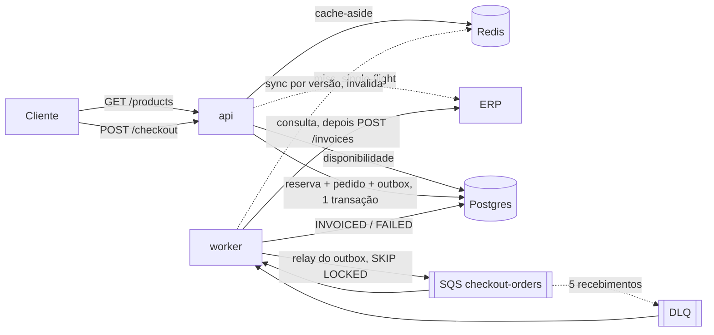
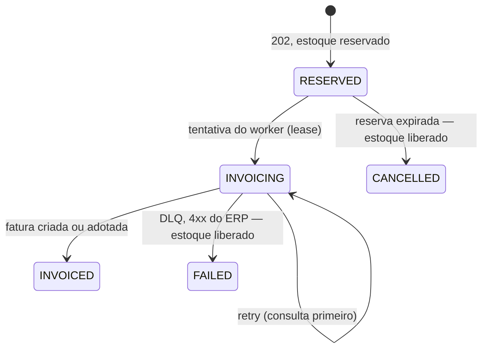
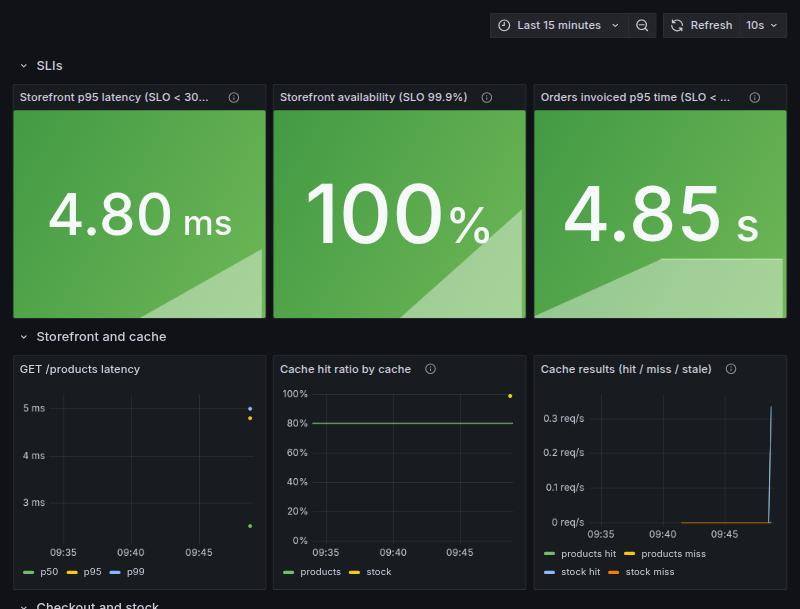

# CaseCellShop — Desafio Técnico Sênior Backend

**Português (Brasil)** · [English](README.md)

> Tradução do [README em inglês](README.md), que é a fonte da verdade. ADRs, runbooks e o OpenAPI continuam em
> inglês.

> Empresa fictícia. Ambiente 100% local: não é necessária conta em nuvem nem no Datadog.

Um backend pequeno que mostra como colocar uma vitrine rápida e correta e um checkout assíncrono na frente de um
ERP lento e instável. Ele cobre os três problemas do case:

| Problema                | O que este serviço faz                                                                                              |
| ----------------------- | ------------------------------------------------------------------------------------------------------------------- |
| Vitrine lenta           | `GET /products` a partir de um cache Redis com TTL por tipo de dado, single-flight e stale-if-error; sincronização com o ERP por versão |
| Overselling             | Estoque reservado no Postgres próprio da loja com um único `UPDATE` condicional atômico; checkout idempotente       |
| Faturamento lento no ERP | `202 Accepted` + outbox transacional + worker SQS com backoff, consulta antes do retry, DLQ e reconciliação        |

Medido localmente (veja [Verificação](#verificação)): `GET /products` com p95 de **4,8 ms** e **99%** de acerto no
cache, contra um ERP que leva 300–500 ms; **10 de 200** checkouts disputando 10 unidades foram aceitos, 0 vendidos a
mais; com 30% de erros e 20% de timeouts no ERP, **0** faturas duplicadas.

## Índice

- [Início rápido](#início-rápido)
- [API](#api)
- [Como funciona](#como-funciona)
- [Proteção de pico no checkout](#proteção-de-pico-no-checkout)
- [Decisões e trade-offs](#decisões-e-trade-offs)
- [Observabilidade: logs, métricas, traces, SLOs, alertas](#observabilidade)
- [Testes](#testes)
- [Verificação](#verificação)
- [Simplificações e limitações](#simplificações-e-limitações)
- [Estrutura do projeto e documentação](#estrutura-do-projeto-e-documentação)
- [Uso de IA](#uso-de-ia)

## Início rápido

Requisitos: Docker com Compose v2, `make`, `curl`. Node é opcional (`./scripts/npx.sh` roda as ferramentas em um
container).

```bash
make up                         # api, worker, erp-mock, postgres, redis, sqs
curl localhost:3000/health      # postgres, redis, sqs, erp = ok
make test                       # 157 testes + cobertura (roda dentro do container da api)
make obs                        # + otel-collector, jaeger, prometheus, grafana (exporta traces)
```

Sem `make`: `docker compose up -d --build` e
`OTEL_TRACES_EXPORTER=otlp docker compose --profile obs up -d --build`.

Uma compra completa:

```bash
curl localhost:3000/products
curl -i localhost:3000/checkout -H 'content-type: application/json' -H 'Idempotency-Key: demo-1' \
  -d '{"items":[{"sku":"CASE-IPH15-BLK","quantity":1}]}'          # 202 + Location
curl localhost:3000/orders/<orderId>/status                         # RESERVED → INVOICING → INVOICED
```

| URL                                         | O quê                                                         |
| ------------------------------------------- | ------------------------------------------------------------- |
| http://localhost:3000/docs                  | **Swagger UI**: ler e testar a API no navegador               |
| http://localhost:3000/openapi.yaml          | O contrato como texto (também em `docs/openapi.yaml`)         |
| http://localhost:3000/metrics               | Métricas da API (worker: `:9464/metrics`)                     |
| http://localhost:4000/admin/config          | Caos do ERP (GET/POST)                                        |
| http://localhost:9325                       | Estatísticas da fila (ElasticMQ)                              |
| http://localhost:16686                      | Traces (Jaeger, com `make obs`)                               |
| http://localhost:9090/alerts                | Alertas (Prometheus, com `make obs`)                          |
| http://localhost:3001                       | Dashboard do Grafana, sem login (`make obs`)                  |

Outros alvos: `make chaos` / `make calm` (degrada / restaura o ERP), `make load` (corrida de overselling no k6;
rode depois de `make reset && make up`), `make reset` (apaga o banco e refaz o seed), `make logs`.

## API

Contrato completo com schemas e exemplos: [`docs/openapi.yaml`](docs/openapi.yaml), também exibido como uma Swagger UI
interativa em http://localhost:3000/docs (com "Try it out", sem precisar baixar nada).

| Rota                           | Sucesso                                           | Erros                                    |
| ------------------------------ | ------------------------------------------------- | ---------------------------------------- |
| `GET /products[?sku=]`         | `200` (pode vir velho, `x-cache`)                 | `400`, `404`, `500`, `503`               |
| `POST /checkout`               | `202 { orderId, status, statusUrl }` + `Location` | `400`, `409`, `415`, `422`, `429`, `500`, `503` |
| `GET /orders/{orderId}/status` | `200` com histórico                               | `400`, `404`, `500`, `503`               |

Todo erro tem o mesmo formato e um `code` estável:

```json
{ "error": { "code": "OUT_OF_STOCK", "message": "Not enough stock for: CASE-S24-RED", "details": { "skus": ["CASE-S24-RED"] } } }
```

| Status | Códigos                                                                                   |
| ------ | ----------------------------------------------------------------------------------------- |
| 400    | `VALIDATION_ERROR`, `INVALID_JSON`, `MISSING_IDEMPOTENCY_KEY`, `INVALID_IDEMPOTENCY_KEY`  |
| 404    | `PRODUCT_NOT_FOUND`, `ORDER_NOT_FOUND`, `ROUTE_NOT_FOUND`                                  |
| 409    | `OUT_OF_STOCK` (nada foi reservado)                                                        |
| 415    | `UNSUPPORTED_MEDIA_TYPE`                                                                   |
| 422    | `IDEMPOTENCY_KEY_REUSED` (mesma chave, outros itens), `UNKNOWN_SKU`                        |
| 429    | `RATE_LIMITED` (limite de checkouts por cliente; `Retry-After`, nada reservado)             |
| 500    | `INTERNAL_ERROR` (nada interno vaza; o `x-correlation-id` leva até os logs)                |
| 503    | `CATALOG_UNAVAILABLE` (ERP fora e nada em cache), `DEPENDENCY_UNAVAILABLE`, `OVERLOADED` (checkout no limite de capacidade; `Retry-After`, nada reservado) |

Toda resposta traz `x-correlation-id` (devolvido se enviado, gerado caso contrário).

## Como funciona



**Vitrine.** Nome e preço dos produtos vêm do ERP e ficam atrás do cache; a disponibilidade vem do `inventory`
próprio da loja (as mesmas linhas em que o checkout reserva). Cada entrada tem uma janela *fresca* (preço 60 s,
estoque 5 s) e uma janela *velha* (+120 s). Passada a janela fresca, um único chamador atualiza (compartilhamento
de promessa no processo + lock `SET NX` no Redis entre instâncias) enquanto os demais recebem o valor anterior; se
o ERP falha, o valor anterior é servido com `meta.stale: true`, `x-cache: stale` e `Cache-Control: no-store`. Um
job do worker consulta o catálogo do ERP a cada 10 s e, quando uma `version` muda, atualiza o read model e invalida
o cache, então uma mudança de preço aparece em segundos, não depois do TTL.

**Checkout.** Uma transação: insere o pedido (`idempotency_key` UNIQUE), reserva cada SKU em ordem alfabética com
`UPDATE inventory SET available = available - q, reserved = reserved + q WHERE sku = $1 AND available >= q`,
grava a linha de `order_events` e a linha de `outbox`. Se faltar estoque em qualquer SKU → `ROLLBACK` → `409`. Os
preços são lidos no servidor. A mesma chave com os mesmos itens devolve o pedido original (`202`); com outros
itens, `422`.

**Faturamento.** O worker repassa o outbox para o SQS e o consome. Cada tentativa pega uma lease curta no pedido,
então uma entrega duplicada e simultânea espera em vez de também chamar o ERP. A partir da segunda tentativa, ele
chama `GET /invoices?orderId=` antes de `POST /invoices` (o endpoint de fatura do ERP não é idempotente). Falhas
transitórias são repetidas com backoff exponencial e full jitter via `ChangeMessageVisibility`; após 5
recebimentos a mensagem vai para a DLQ, onde o worker consulta a fatura mais uma vez e encerra o pedido como
`INVOICED` ou `FAILED` (estoque liberado). Um job de reconciliação cancela reservas que expiraram sem nunca serem
faturadas e adota faturas de pedidos parados em `INVOICING`.



Mais detalhes: [`docs/architecture.md`](docs/architecture.md).

## Proteção de pico no checkout

Duas barreiras baratas rodam antes de qualquer estoque ser tocado ([ADR 0009](docs/adr/0009-checkout-load-shedding.md)):

1. **Rate limit por IP do cliente.** `CHECKOUT_RATE_LIMIT_MAX` checkouts por `CHECKOUT_RATE_LIMIT_WINDOW_S` (padrão
   20 a cada 10 s), contados no Redis, então todas as instâncias compartilham a mesma cota. A verificação roda
   antes de o corpo ser lido. Acima da cota → `429 RATE_LIMITED`. Se o Redis cair, o limite é ignorado (fail
   open). O `X-Forwarded-For` só vale com `TRUST_PROXY=true` (ligado no compose para o k6 simular muitos clientes;
   em produção, só atrás de um proxy que sobrescreve o header).
2. **Limite de concorrência por instância com uma fila de espera curta.** No máximo `CHECKOUT_MAX_CONCURRENCY` (16)
   checkouts rodam ao mesmo tempo. Até `CHECKOUT_MAX_QUEUE` (100) esperam, por ordem de chegada, por no máximo
   `CHECKOUT_QUEUE_TIMEOUT_MS` (1 s). Além disso → `503 OVERLOADED`.

As duas respostas trazem `Retry-After`. O cliente deve esperar esse tempo e repetir com a **mesma
`Idempotency-Key`**: nada foi reservado, e o retry devolve o mesmo pedido se uma tentativa anterior tiver passado.

Medido com `make load-peak` (`tests/load/peak.js`): uma multidão de clientes distintos subindo até a taxa ofertada
em 10 s e mantendo-a por 20 s, mais um cliente abusivo a 20 req/s. Uma instância da API num notebook; cada linha é
uma execução após `make reset && make up` (as linhas "desligada" sobem todos os limites). "Admitidos" são as
respostas `202`/`409`. "Não enviados" são iterações que o k6 descartou porque todos os seus 2.000 usuários
virtuais estavam presos esperando.

| Multidão ofertada | Proteção | Atendidos | Admitidos | p95 admitidos | `429` | `503` | p95 de um `429`/`503` | Não enviados |
| --- | --- | --- | --- | --- | --- | --- | --- | --- |
| 1.500 req/s | desligada | 1.203/s | 1.203/s | 28 ms | 0% | 0% | — | 0 |
| 1.500 req/s | ligada | 1.203/s | 1.182/s | 82 ms | 1,3% (o abusivo) | 0,5% | 8 ms | 0 |
| 2.500 req/s | desligada | 1.346/s | 1.346/s | 1,37 s | 0% | 0% | — | 22.480 |
| 2.500 req/s | ligada | 1.988/s | 1.037/s | 135 ms | 0,8% | 47% | 9 ms | 0 |
| 4.000 req/s | desligada | 1.404/s | 1.404/s | 1,40 s | 0% | 0% | — | 61.686 |
| 4.000 req/s | ligada | 3.165/s | 668/s | 248 ms | 0,5% | 78% | 17 ms | 80 |

Em todas as execuções: 0 status inesperados, toda rejeição trouxe `Retry-After`, e o cliente abusivo recebeu
exatamente a sua cota (60 de 600 aceitos). Nenhuma unidade foi vendida a mais: 50 unidades, 50 pedidos.

Como ler. O único processo da API satura em cerca de 1.350 checkouts/s (~110% de CPU). Passado esse ponto, sem
proteção, a latência passa de um segundo e os clientes se acumulam. Com proteção, os checkouts admitidos ficam
abaixo de 250 ms e o excedente recebe uma resposta em 10–20 ms com a dica de quando tentar de novo.

A proteção tem um custo. As rejeições ainda usam a CPU do processo que elas protegem, então a vazão útil sob
sobrecarga cai 25–50%. Abaixo da capacidade, o limite causa alguma fila. Capacidade de verdade vem de mais
instâncias (a capacidade é por instância). O próximo passo é rejeitar na borda (rate limit no load balancer ou na
CDN).

## Decisões e trade-offs

| Decisão | Por quê | Custo / trade-off |
| --- | --- | --- |
| Postgres próprio da loja para estoque, pedidos e outbox ([ADR 0001](docs/adr/0001-postgres-as-shop-database.md)) | O MySQL do ERP é somente leitura para nós; reservas precisam de escrita, `CHECK` e `RETURNING` | Mais um banco para sincronizar com o ERP (job de sync + reconciliação) |
| `UPDATE` condicional atômico em vez de lock | Uma instrução, lock de linha por microssegundos, sem serviço de lock; o `CHECK` do banco é a última barreira | SKUs muito disputados serializam em uma linha; adequado nesta escala, contadores particionados depois |
| Reserva com expiração, fatura depois | O cliente recebe resposta em ~100 ms enquanto o ERP leva segundos | O estoque fica "segurado" por até `RESERVATION_TTL_S`; a reconciliação libera |
| Outbox transacional em vez de publicar dentro da requisição ([ADR 0004](docs/adr/0004-transactional-outbox.md)) | Nenhum pedido sem mensagem, nenhuma mensagem sem pedido | Entrega pelo menos uma vez → o consumidor precisa ser idempotente; latência do relay (~0,5 s) |
| Idempotência no Postgres (chave UNIQUE + hash da requisição) ([ADR 0005](docs/adr/0005-idempotency-strategy.md)) | Fonte da verdade, sobrevive à perda do Redis, serializa o duplo clique | Um `409` não guarda nada, então a mesma chave pode funcionar depois se o estoque voltar |
| Consulta antes do retry + lease de faturamento ([ADR 0007](docs/adr/0007-invoicing-lease-and-dlq-settlement.md)) | O endpoint de fatura do ERP não é idempotente | Uma leitura extra no ERP por retry; uma entrega duplicada espera até a lease (15 s) |
| Cache-aside com janelas fresca/velha, single-flight e sync por versão ([ADR 0006](docs/adr/0006-storefront-cache.md)) | Latência e carga no ERP caem ordens de grandeza sem stampede | Preços podem ter até um intervalo de sync de idade (10 s); cópias velhas são sinalizadas |
| Rate limit por IP + limite de concorrência por instância com fila curta ([ADR 0009](docs/adr/0009-checkout-load-shedding.md)) | Latência limitada e um `429`/`503` rápido e reenviável em vez de todas as requisições estourarem o timeout juntas | Sob sobrecarga a vazão útil cai (rejeitar também custa CPU); usuários atrás do mesmo NAT dividem a cota |
| O estoque exibido é informativo | A reserva é a verificação real; cachear estoque por 5 s é seguro | Um produto pode aparecer "em estoque" e depois receber `409` |
| Traces exportados só quando há um collector ([ADR 0008](docs/adr/0008-export-traces-only-with-a-collector.md)) | A falta do collector esgotava as resoluções de DNS e causava timeouts de 2 s | Só `make up` não tem interface de traces (os trace ids continuam nos logs) |
| ElasticMQ como SQS, CommonJS para o OTel ([ADR 0002](docs/adr/0002-elasticmq-as-local-sqs.md), [0003](docs/adr/0003-commonjs-for-otel.md)) | O mesmo código do AWS SDK roda na AWS; a auto-instrumentação exige CJS | — |

## Observabilidade

O OpenTelemetry Collector é o único ponto de troca para o Datadog: substitua os exporters de Jaeger/Prometheus em
[`infra/otel/collector.yaml`](infra/otel/collector.yaml) pelo exporter `datadog` (já presente na imagem contrib,
comentado). A aplicação não muda.

**Logs** — JSON do pino. Toda linha traz `service`, `correlationId`, `requestId` (API) ou `orderId`, além de
`trace_id`/`span_id` do OpenTelemetry. O correlation id viaja no payload do outbox, na mensagem do SQS, nos logs do
worker e no header `x-correlation-id` enviado ao ERP. Payloads nunca são logados.

**Métricas** — um contrato compartilhado com os alertas (sem labels de alta cardinalidade; `route` é o padrão da
rota):

| Métrica | Tipo | Labels |
| --- | --- | --- |
| `http_request_duration_seconds` | histogram | `route`, `method`, `status` |
| `cache_requests_total` | counter | `cache` = products/stock, `result` = hit/miss/stale |
| `checkout_requests_total` | counter | `outcome` = accepted/out_of_stock/duplicate/invalid/rate_limited/shed |
| `checkout_inflight` / `checkout_queue_waiting` | gauge | — (por instância) |
| `stock_reservation_conflicts_total` | counter | `sku` |
| `inventory_available` | gauge | `sku` |
| `checkout_queue_depth` | gauge | `queue` = main/dlq |
| `erp_requests_total` / `erp_request_duration_seconds` | counter / histogram | `operation`, `outcome` = success/error/timeout/client_error |
| `order_processing_duration_seconds` | histogram | `final_status` = INVOICED/FAILED/CANCELLED |

**Traces** — auto-instrumentação (HTTP, Fastify, pg, ioredis, AWS SDK) mais spans de negócio: `cache.get`
(`cache.result`), `stock.reserve`, `outbox.publish`, `order.process`, `erp.lookup`, `erp.invoice`,
`order.dead_letter`. O contexto do trace é gravado na linha do outbox e restaurado pelo worker, então um checkout é
**um único trace** nos dois serviços (31 spans na execução local: `POST /checkout` → `stock.reserve` → … →
`order.process` → `erp.invoice`).

**SLOs**

| SLI | SLO | Fonte |
| --- | --- | --- |
| Latência de `GET /products` | p95 < 300 ms em 30 dias | `http_request_duration_seconds{route="/products"}` |
| Disponibilidade de `GET /products` | 99,9% sem 5xx (respostas velhas contam como disponíveis) | o mesmo, por `status` |
| Checkout até a fatura | 99% dos pedidos `INVOICED` em até 2 min | `order_processing_duration_seconds{final_status="INVOICED"}` |
| Overselling | 0 (`inventory_available` nunca negativo) | `inventory_available`, `CHECK` do banco |

**Alertas** ([`infra/prometheus/alerts.yml`](infra/prometheus/alerts.yml), cada um ligado a um runbook em
[`docs/runbooks/`](docs/runbooks/)): `StorefrontHighLatency`, `CacheHitRatioLow`, `CacheServingStale`,
`CheckoutQueueBacklog`, `MessagesInDLQ`, `OrdersFailingInvoicing`, `ReservationsExpiring`, `InvoicingTooSlow`,
`ErpHighErrorRate`, `PossibleOverselling`, `CheckoutLoadShedding`.

**Dashboard** — provisionado no Grafana (`make obs`, http://localhost:3001): SLIs, latência e hit ratio da vitrine,
resultados do cache, checkouts por resultado, conflitos e estoque por SKU, profundidade da fila, status finais, erros
e latência do ERP.



**O equivalente no Datadog**

| Aqui | Datadog |
| --- | --- |
| Regra do Prometheus `StorefrontHighLatency` | Monitor de métrica em `p95:http_request_duration_seconds{route:/products}` `> 0.3` por 5 min, com o runbook na mensagem |
| `CacheHitRatioLow` / `ErpHighErrorRate` | Monitores com fórmula (`hit / total`, `errors / total`) |
| `MessagesInDLQ` | Monitor de métrica, ou `aws.sqs.approximate_number_of_messages_visible` da integração AWS SQS |
| Tabela de SLOs acima | SLOs do Datadog (baseados em métrica) com alertas de burn rate (ex.: 14,4× em 1 h) |
| Dashboard do Grafana | Dashboard com os mesmos widgets; mapa de serviços do APM a partir dos traces OTel |
| `correlationId` nos logs | Faceta de log + correlação com traces (`dd.trace_id` do OTel) |

Runbooks: [vitrine lenta](docs/runbooks/slow-storefront.md), [ERP degradado](docs/runbooks/erp-degraded.md),
[DLQ / pedidos com falha](docs/runbooks/dlq-growing.md), [suspeita de overselling](docs/runbooks/suspected-oversell.md),
[descarte de carga no checkout](docs/runbooks/checkout-shedding.md).

## Testes

`make test` roda 174 testes no container da api com um piso de cobertura (80% das linhas; hoje ~92%). Os testes
unitários ficam ao lado do código (`src/**/*.test.ts`) e usam fakes em memória; os de integração
(`tests/integration/`) rodam contra o Postgres, o Redis e o SQS do compose, em um banco `shop_test` isolado, recriado
a partir de `infra/postgres/init.sql` a cada execução.

| Área | O que é provado |
| --- | --- |
| Concorrência | 40 compradores em paralelo para 5 unidades → exatamente 5 aceitos, 35 `409`; pedidos de várias unidades aceitam `min(N, S)`; tudo ou nada em carrinhos com vários itens; carrinhos cruzados nunca dão deadlock |
| Idempotência | duplo clique simultâneo → um pedido, uma reserva, uma linha de outbox; mesma chave + outros itens → `422`; a ordem dos itens não importa; uma chave que deu `409` pode ser reenviada |
| Cache | single-flight (50 misses concorrentes → 1 chamada ao ERP; duas instâncias compartilhando o Redis → 1 chamada), TTLs fresco/velho, stale-if-error, Redis fora → bypass, lock liberado em caso de falha, sync por versão |
| Worker | timeout que criou a fatura → adotada, nunca duplicada; entregas duplicadas concorrentes → uma fatura (lease); 4xx → `FAILED` + estoque devolvido; a DLQ encerra uma vez; reconciliação; mensagens inválidas; limites do backoff; outbox `SKIP LOCKED` com dois relays; ponta a ponta sobre uma fila real |
| HTTP | matriz de status por rota: 200/202, 400 (13 casos de corpo, chave e parâmetro inválidos), 404, 409, 415, 422, 429, 500 (sem vazamento), 503; correlation id; métricas rotuladas pelo padrão da rota |
| Proteção de pico | `429` além da cota por IP com `Retry-After`, nada reservado; cota compartilhada por duas instâncias via Redis; `X-Forwarded-For` ignorado se não for confiável; Redis fora → fail open; uma requisição na fila roda quando um slot libera; fila cheia ou espera estourada → `503 OVERLOADED` com `Retry-After`, e o retry com a mesma chave recebe o pedido; requisições inválidas nunca ocupam slot; limitador FIFO e slot liberado em caso de erro |
| Contrato | respostas reais validadas contra os schemas do `docs/openapi.yaml` com o Ajv |
| Cliente do ERP | contra o ERP mock de verdade, com falhas forçadas pela API admin dele: 5xx, timeout, 4xx, fatura não idempotente |

O teste de carga do k6 (`make load`) coloca 50 usuários virtuais disputando um SKU, cada um com duplo clique.
`make load-peak` roda o pico de checkout descrito em [Proteção de pico no checkout](#proteção-de-pico-no-checkout).

## Verificação

Executado na stack local depois de `make reset && make up`:

| Verificação | Resultado |
| --- | --- |
| `make load` (200 checkouts, 10 unidades, duplos cliques) | 10 aceitos, 190 `409`, 100% com o mesmo `orderId` no duplo clique, 0% de falhas inesperadas; os 10 ficam `INVOICED` com uma fatura cada, `available = 0`, `reserved = 0` |
| `make load-peak` (`PEAK_RATE` 1.500 / 2.500 / 4.000) | ver [Proteção de pico no checkout](#proteção-de-pico-no-checkout); 0 status inesperados, 0 vendido a mais |
| `make chaos` + 12 pedidos | `GET /products` 200 o tempo todo (cache); 11 `INVOICED` (≤ 3 tentativas), 1 `FAILED` após 5 tentativas via DLQ com o estoque liberado; 0 faturas duplicadas |
| Mudança de preço no ERP | visível em `GET /products` após ~7 s (sync), não após os 60 s do TTL; read model atualizado para o checkout |
| `GET /products` com cache quente | p95 de 4,8 ms, hit ratio de 99% (chamada fria ao ERP: ~400 ms) |
| `make obs` + um checkout | um trace, 31 spans entre `casecellshop-api` e `casecellshop-worker` |

## Simplificações e limitações

- **Sem autenticação, pagamento, front end ou deploy**, como o desafio permite. O checkout reserva estoque e fatura;
  um fluxo real autorizaria o pagamento antes de faturar.
- **O ERP é um mock**, com os mesmos modos de falha (latência, 5xx, travamentos, faturamento não idempotente). Nosso
  inventário é populado em sincronia com ele; reposições no ERP não são trazidas para o `inventory` (só nomes,
  preços e novos SKUs). Em produção isso seria um feed de CDC/estoque com reconciliação própria.
- **O sync do catálogo faz polling** no ERP a cada 10 s porque não podemos alterar o ERP para que ele envie eventos.
  CDC no binlog do MySQL do ERP (há acesso de leitura) eliminaria o polling.
- **O OpenAPI é escrito à mão**; um teste de contrato o mantém fiel, em vez de gerá-lo a partir do código.
- **Mudanças de schema** vão em `infra/postgres/init.sql` (ainda sem ferramenta de migração); `make reset` as aplica.
- **Um único processo de worker** roda relay, consumidores, DLQ, reconciliação, sync e gauges. São loops
  independentes e podem virar deploys separados.
- **A disputa por SKU muito vendido** é limitada a uma linha do Postgres por SKU; é a troca certa aqui, mas uma
  venda relâmpago muito maior que esta escala exigiria estoque particionado ou um serviço de reservas.
- **Um `409` não é lembrado** para a sua chave de idempotência (nada é gravado no rollback), então reenviar a chave
  reavalia o estoque. Isso é deliberado e testado.

## Estrutura do projeto e documentação

```
src/
  api/                       # app Fastify (correlação, métricas, contrato de erros), bootstrap
  worker/                    # loops: relay do outbox, consumidores (principal + DLQ), reconciliação, sync, gauges
  modules/
    catalog/                 # cache, service, sync, repository, routes, schemas
    checkout/  orders/       # POST /checkout, GET /orders/:id/status
    invoicing/  outbox/      # máquina de estados do worker, relay do outbox
  shared/                    # config, db, redis, sqs, cache store, cliente do ERP, logger, métricas, tracing, erros
  observability/tracing.ts   # bootstrap do OpenTelemetry (primeiro import de todo entrypoint)
tests/integration/  tests/support/  tests/load/
erp-mock/  infra/  docs/
```

| Onde | O quê |
| --- | --- |
| [docs/architecture.md](docs/architecture.md) | Componentes, fluxo do checkout, estados do pedido, estratégia de cache |
| [docs/adr/](docs/adr/) | Registros de decisões de arquitetura |
| [docs/runbooks/](docs/runbooks/) | O que fazer quando cada alerta dispara |
| [docs/openapi.yaml](docs/openapi.yaml) | Contrato da API |
| [CONTRIBUTING.md](CONTRIBUTING.md) | Setup, Git flow, convenção de commits, checklist de PR |
| [CLAUDE.md](CLAUDE.md), [.claude/](.claude/) | Orientações para o assistente de IA: regras por caminho e skills |
| [CHANGELOG.md](CHANGELOG.md) | Histórico de versões |

## Uso de IA

A IA (Claude) foi usada do começo ao fim, com direção e revisão: o [`PROMPTS.md`](PROMPTS.md) registra cada prompt
relevante, o que foi aproveitado e o que foi corrigido ou rejeitado. Correções que vieram de rodar o sistema: a
exaustão de DNS por trás dos `503` intermitentes, corpos `text/plain` sendo interpretados em vez de rejeitados com
`415`, e um cliente Redis ainda conectando que levantava um erro não classificado. Correções que vieram da revisão ao
desenhar os testes (nunca vistas falhando, por isso cada uma agora tem um teste que a protege): a fatura duplicada
possível sob entregas concorrentes (corrigida com uma lease), as métricas de cache contadas por requisição e o
isolamento dos testes em relação ao worker em execução.
