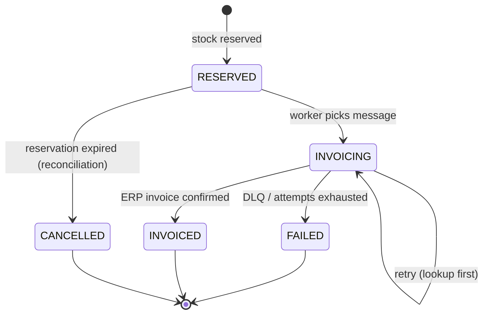

# Architecture

## Context

CaseCellShop sells phone cases. Product, price and stock live in a legacy ERP (read-only MySQL behind an HTTP
API) that is slow, unstable and whose invoicing endpoint is **not idempotent**. Peak traffic must not
overload the ERP, oversell stock or create duplicate invoices.

## Components

| Component                                      | Responsibility                                                                                       |
| ---------------------------------------------- | ---------------------------------------------------------------------------------------------------- |
| `api`                                          | `GET /products` (cached), `POST /checkout` (reserve + enqueue), `GET /orders/:id/status`, `/metrics` |
| `worker`                                       | Outbox relay → SQS, SQS consumer → ERP invoicing with retry/lookup, DLQ handling, reconciliation     |
| Postgres                                       | Shop-owned data: storefront read model, inventory/reservations, orders, outbox, order events         |
| Redis                                          | Storefront cache, single-flight locks, idempotency fast path                                         |
| SQS (ElasticMQ)                                | `checkout-orders` queue + `checkout-orders-dlq` (redrive after 5 receives)                           |
| ERP mock                                       | Simulates latency, 5xx, timeouts and non-idempotent invoicing                                        |
| OTel Collector → Jaeger / Prometheus / Grafana | Traces, metrics, alerts (Datadog stand-in)                                                           |

## Checkout flow

```mermaid
sequenceDiagram
  participant C as Client
  participant A as API
  participant P as Postgres
  participant W as Worker
  participant Q as SQS
  participant E as ERP
  C->>A: POST /checkout (Idempotency-Key)
  A->>P: BEGIN; insert order (unique key)
  A->>P: UPDATE inventory ... WHERE available >= q
  A->>P: insert outbox + order_event; COMMIT
  A-->>C: 202 { orderId, status: RESERVED }
  W->>P: outbox rows FOR UPDATE SKIP LOCKED
  W->>Q: SendMessage(orderId)
  W->>P: set published_at
  Q->>W: ReceiveMessage
  W->>E: GET /invoices?orderId= (already invoiced?)
  alt not invoiced
    W->>E: POST /invoices (timeout, backoff + jitter)
  end
  W->>P: status INVOICED + order_event; COMMIT
  W->>Q: DeleteMessage
  Note over Q,W: after 5 failed receives → DLQ → order FAILED, reservation released
```

## Order states



## Storefront cache

- Cache-aside in Redis with TTL per data type: catalog `300s`, price `60s`, stock `5s` (`CACHE_TTL_*`).
- **Single-flight:** on a miss, one request takes a short Redis lock and refreshes; others wait briefly or
  get the previous value — prevents a stampede on the ERP.
- **Stale-if-error:** if the ERP fails, serve the last value for up to `CACHE_STALE_IF_ERROR_S` and count
  `cache_requests_total{result="stale"}`.
- Displayed stock is advisory; the authoritative check is the reservation in Postgres.

## Decisions

See [`adr/`](adr/). Operational procedures in [`runbooks/`](runbooks/).
